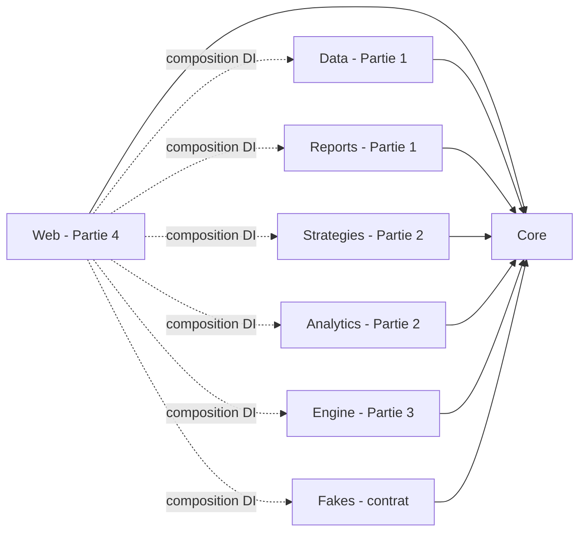

# Contrat QuantBacktest — v1.0 (gelé)

> Source de vérité du **code** : `src/QuantBacktest.Core`. Ce document fixe la **sémantique**, c'est-à-dire tout ce que les signatures ne peuvent pas dire.
> Les règles portent un identifiant (X3, M7, R6...). Les notices, le code et les tests citent ces identifiants.
> En cas de doute ou de désaccord : issue `contract-change` (voir section 14). On ne devine jamais, on ne contourne jamais.

## 1. Architecture

Règle d'or : **aucun projet ne référence le projet d'une autre partie**, seulement `Core`. Seul `Web` (racine de composition) référence tous les projets, et uniquement pour appeler leurs méthodes `AddQuantBacktest*`. Les parties communiquent exclusivement par les interfaces de `Core`, injectées par DI.

Flux d'un backtest : `Web` → `IBacktestService` (Engine) → `IStrategyCatalog` (Strategies, qui lit `ICustomStrategyStore` de Data) + `IMarketDataService` (Data) → `IBacktestEngine` (Engine) → `BacktestResult` → `Web` affiche ; `IMonteCarloService` (Analytics) et `IReportGenerator` (Reports) prennent ce `BacktestResult` en entrée.

## 2. Qui implémente quoi

| Interface (dans `Core/Abstractions`) | Implémentée par | Projet | Utilisée par |
|---|---|---|---|
| `IMarketDataService` | Partie 1 | Data | Engine, Web |
| `ICustomStrategyStore` | Partie 1 | Data | Strategies, Web |
| `IReportGenerator` | Partie 1 | Reports | Web |
| `IStrategy`, `IStrategyCatalog`, `ICustomStrategyFactory` | Partie 2 | Strategies | Engine, Web |
| `IMonteCarloService` | Partie 2 | Analytics | Web |
| `IBacktestEngine`, `IBacktestService`, `IParameterSweepService` | Partie 3 | Engine | Web |

Méthodes d'enregistrement (noms, signatures et contenu **figés**) :

| Projet | Méthode | Enregistre (toujours en `Singleton`) |
|---|---|---|
| Data | `AddQuantBacktestData(IConfiguration configuration)` | `IMarketDataService`, `ICustomStrategyStore` |
| Reports | `AddQuantBacktestReports()` | `IReportGenerator` |
| Strategies | `AddQuantBacktestStrategies()` | `IStrategyCatalog`, `ICustomStrategyFactory` |
| Analytics | `AddQuantBacktestAnalytics()` | `IMonteCarloService` |
| Engine | `AddQuantBacktestEngine()` | `IBacktestEngine`, `IBacktestService`, `IParameterSweepService` |
| Fakes | `AddFakeData()`, `AddFakeReports()`, `AddFakeStrategies()`, `AddFakeAnalytics()`, `AddFakeEngine()` | les mêmes interfaces, en version factice |

`Web/Program.cs` choisit, **partie par partie**, entre le vrai service et le fake avec les clés `QuantBacktest:UseFakes:Data`, `:Reports`, `:Strategies`, `:Analytics`, `:Engine`. On peut donc brancher une partie réelle dès qu'elle est mergée, sans attendre les autres.

Les `Fakes` ne sont **pas** une référence de comportement : ils produisent des données plausibles pour développer en parallèle. La référence est ce document.

## 3. Modèles : sémantique commune

- **Fractions partout** : `0.12` = 12 %. Les pourcentages n'existent qu'à l'affichage (Web, PDF).
- **`decimal`** pour les prix, quantités, montants ; **`double`** pour les rendements, ratios et statistiques.
- **`PriceSeries`** : barres triées par date croissante, dates uniques, prix strictement positifs, `High >= max(Open, Close)`, `Low <= min(Open, Close)`. `IsAdjusted = true` : les **quatre** prix sont ajustés (splits, dividendes). L'ajustement est le travail exclusif de la Partie 1.
- **Paramètres d'un backtest** : `IReadOnlyDictionary<string, double>`, clés = `ParameterDefinition.Key`. Clé absente : valeur par défaut.
- **`BacktestResult.Bars`** : uniquement les barres de la période testée. `Equity` a exactement un point par barre de `Bars`, `Indicators[k].Values` aussi.
- **Ratios indéfinis** : `null` (affiché « n/a »), jamais `NaN`, jamais infini, jamais remplacé par 0.
- **Textes destinés à l'utilisateur** (messages d'erreur, documentation de stratégie, libellés) : en anglais.

## 4. Exécution des ordres (Partie 3 l'implémente, Partie 2 la respecte)

Notations : barres `bars[0..n-1]`, `first` et `last` = indices de la première et de la dernière barre de la période. `fee = FeeRate`, `slip = SlippageRate`.

| Id | Règle |
|---|---|
| X1 | **Période** : barres avec `From <= date <= To` (bornes incluses, `null` = bornes de la série). `From > To` ou moins de 2 barres : `BacktestValidationException`. |
| X2 | **Warm-up** : le moteur appelle `GenerateSignals` et `ComputeIndicators` avec `bars[0..last]` (y compris les barres avant `From`). Il ne garde des indicateurs que la tranche `[first..last]`. |
| X3 | **Pas de look-ahead** : `signals[i]` est émis à la clôture de la barre `i` et ne dépend que de `bars[0..i]`. |
| X4 | **Exécution différée** : le signal de la barre `i` (avec `first <= i < last`) s'exécute à l'**Open de la barre `i+1`**. Les signaux des barres avant `first` et le signal de la barre `last` sont ignorés. |
| X5 | **Positions** : long uniquement, sans levier, 100 % du cash. `Buy` à plat : entrée. `Sell` en position : sortie totale. `Buy` en position, `Sell` à plat, `Hold` : rien. |
| X6 | **Prix d'exécution (fill)** : achat `fill = prix × (1 + slip)` ; vente `fill = prix × (1 - slip)`. Quantité fractionnaire `q = cash / (fill × (1 + fee))`. Coût d'achat = `q × fill × (1 + fee)`. Produit de vente = `q × fill × (1 - fee)`. Frais d'un côté = `q × fill × fee`. |
| X7 | **Ordre de traitement de chaque barre `i` de `first` à `last`** : (a) exécuter à l'Open le signal en attente de la barre `i-1` (X4) ; (b) si une position est ouverte (y compris ouverte en (a)), appliquer les sorties de protection (X8) ; (c) si `i = last` et qu'une position reste ouverte, la liquider au Close (X10) ; (d) enregistrer le point d'équité (X11). |
| X8 | **Sorties de protection**. `E` = prix d'entrée (fill). `peak` = max de `E` et des `High` des barres d'indice `entrée` à `i - 1` inclus (sur la barre d'entrée elle-même, `peak = E`). Niveau stop `S` = maximum des niveaux actifs parmi `E × (1 - StopLossFraction)` et `peak × (1 - TrailingStopFraction)` ; cible `T = E × (1 + TakeProfitFraction)`. **Gap** (sauf sur la barre d'entrée) : si `Open <= S`, sortie à l'Open ; sinon si `Open >= T`, sortie à l'Open. **Intrabarre** : sinon si `Low <= S`, sortie au prix `S` ; sinon si `High >= T`, sortie au prix `T`. Le stop passe toujours avant la cible (hypothèse prudente). Le prix de référence obtenu passe ensuite par X6 (slippage, frais). |
| X9 | **Raison de sortie** : signal → `Signal` ; cible → `TakeProfit` ; stop → `TrailingStop` si le niveau trailing est strictement supérieur au niveau stop-loss (ou si seul le trailing est actif), sinon `StopLoss` ; liquidation finale → `EndOfData`. Après une sortie de protection, le signal de la clôture de la même barre peut rouvrir une position à la barre suivante. |
| X10 | **Liquidation finale** : position ouverte à la fin de la barre `last` → vendue au Close (X6), raison `EndOfData`. |
| X11 | **Équité** : `cash + q × Close` à chaque clôture (après (a), (b), (c)). `InPosition = true` si une position était détenue à cette clôture (la liquidation finale compte comme détenue). Le premier point vaut toujours le capital initial (aucune exécution n'est possible sur la barre `first`, X4). |
| X12 | **`HoldingBars`** : nombre de clôtures franchies en position = `indice de sortie - indice d'entrée` pour une sortie à l'Open ou intrabarre ; `+1` pour `EndOfData`. Un stop touché sur la barre d'entrée donne 0. |
| X13 | **`Trade`** : prix = fills ; `Fees` = frais d'entrée + frais de sortie ; `NetProfit = produit de vente - coût d'achat` ; `ReturnFraction = NetProfit / coût d'achat`. Trades ordonnés par date d'entrée. |
| X14 | **Benchmark buy & hold** : achat à l'Open de la barre `first` (slippage et frais d'entrée), valorisé à chaque Close, jamais vendu, sans protection. |
| X15 | **Drawdown par point** : `(pic - équité) / pic`, pic initialisé au capital initial, valeur >= 0 ; même règle pour le benchmark. |

**Validation d'une requête** (faite par `IBacktestService`, Partie 3 ; le moteur revalide X1 et les réglages d'exécution) : symbole conforme à `Conventions.SymbolPattern` après normalisation ; stratégie connue ; timeframe dans `SupportedTimeframes` ; chaque clé de paramètre connue, valeur dans `[Min, Max]`, entière si `Integer` ; `InitialCapital > 0` ; `FeeRate` dans `[0, MaxFeeRate]` ; `SlippageRate` dans `[0, MaxSlippageRate]` ; `StopLossFraction` dans `]0, MaxStopLossFraction]` ; `TakeProfitFraction` dans `]0, MaxTakeProfitFraction]` ; `TrailingStopFraction` dans `]0, MaxTrailingStopFraction]` ; `RiskFreeRate` dans `[0, MaxRiskFreeRate]`. Chaque erreur : `BacktestValidationException` avec un message anglais qui nomme le champ et la plage.

## 5. Métriques

`P = Conventions.PeriodsPerYear(timeframe)` (252 ou 52). `E_0..E_{n-1}` = équité de la stratégie, `I` = capital initial, `r_t = E_t / E_{t-1} - 1` pour `t = 1..n-1`, `rf_p = RiskFreeRate / P`.

| Id | Champ | Définition |
|---|---|---|
| M1 | `FinalEquity` | `E_{n-1}` |
| M2 | `CumulativeReturn` | `FinalEquity / I - 1` |
| M3 | `AnnualizedReturn` | `(FinalEquity / I)^(1 / années) - 1`, `années = (dernière date - première date).Days / 365.25` ; 0 si `années <= 0` ou `FinalEquity <= 0` |
| M4 | `AverageReturnPerPeriod` | moyenne des `r_t` (0 s'il n'y en a aucun). Affiché « Average daily return » ou « Average weekly return » |
| M5 | `AnnualizedVolatility` | écart-type **échantillon** (n-1) des `r_t` × `sqrt(P)` ; 0 si moins de 2 rendements |
| M6 | `SharpeRatio` | `(moyenne(r_t) - rf_p) / écart-type(r_t) × sqrt(P)` ; `null` si moins de 2 rendements ou écart-type nul |
| M7 | `SortinoRatio` | `(moyenne(r_t) - rf_p) / DD × sqrt(P)` avec `DD = sqrt( somme(min(0, r_t - rf_p)^2) / nombre de r_t )` ; `null` si moins de 2 rendements ou `DD = 0` |
| M8 | `MaxDrawdown` | plus grand `(pic - E_t) / pic`, pic initialisé à `I` ; >= 0 |
| M9 | `CalmarRatio` | `AnnualizedReturn / MaxDrawdown` ; `null` si `MaxDrawdown = 0` |
| M10 | `TradeCount`, `WinRate` | nombre de trades ; part des trades avec `NetProfit > 0` (0 si aucun trade) |
| M11 | `ProfitFactor` | somme des `NetProfit > 0` / valeur absolue de la somme des `NetProfit < 0` ; `null` s'il n'y a aucun trade perdant |
| M12 | `Exposure` | nombre de points avec `InPosition` / nombre de points |
| M13 | Benchmark | mêmes formules sur la courbe du benchmark ; `TradeCount = 1` ; `WinRate = 1` si `FinalEquity > I`, sinon 0 ; `ProfitFactor = null` ; `Exposure = 1` |
| M14 | Robustesse | aucune valeur `NaN` ni infinie ; un ratio indéfini vaut `null` ; une série plate ou zéro trade ne lève jamais d'exception |

## 6. Heatmap d'optimisation (Partie 3 calcule, Partie 4 affiche)

| Id | Règle |
|---|---|
| O1 | **Axes** : valeurs `Min + k × Step` pour `k = 0, 1, ...` tant que `<= Max + 1e-9`, arrondies à 10 décimales. `Step > 0`, `Min <= Max`. Les deux clés sont des paramètres **distincts** de la stratégie, bornes comprises dans le `[Min, Max]` de leur définition, valeurs entières pour un paramètre `Integer`. La stratégie doit avoir au moins 2 paramètres. Nombre de cellules `<= Conventions.MaxSweepCells`. Toute violation : `BacktestValidationException`. |
| O2 | **Cellule** : `BaseRequest` avec les deux paramètres remplacés, validée et simulée exactement comme un backtest normal. Les données sont chargées **une seule fois**. Combinaison invalide (relation entre paramètres violée...) : `Value = null`, `TradeCount = 0`, `Error` = message. Métrique indéfinie : `Value = null`, `Error = null`. |
| O3 | **Meilleure cellule** : plus grande `Value` non nulle ; égalité départagée par le plus petit `Y` puis le plus petit `X` ; `null` si aucune. |
| O4 | **Avertissement d'overfitting** : `BestNeighborhoodAverage` = moyenne des `Value` non nulles des 8 cellules voisines de la meilleure (moins sur les bords), `null` s'il n'y en a aucune. `IsIsolatedPeak = Best != null && Best.Value > 0 && (BestNeighborhoodAverage == null \|\| BestNeighborhoodAverage < 0.5 × Best.Value)`. |
| O5 | **Ordre et déterminisme** : cellules en ordre ligne par ligne (pour chaque `Y`, tous les `X`). Résultat identique à chaque appel. Le `CancellationToken` est vérifié entre deux cellules. |

## 7. Données (Partie 1)

| Id | Règle |
|---|---|
| D1 | **Sources**. API Alpha Vantage, plan gratuit : `TIME_SERIES_DAILY` en `outputsize=compact` (100 dernières barres) ; `TIME_SERIES_WEEKLY` (historique complet). Les variantes ajustées ne sont utilisées que si le spike de la Partie 1 prouve qu'elles sont gratuites. **Fichiers de départ** : `data/seed/<SYMBOL>_daily.csv` et `data/seed/<SYMBOL>_weekly.csv`, au format CSV d'Alpha Vantage ; ils portent les longues historiques que le plan gratuit ne fournit pas (source et méthode documentées par la Partie 1 dans son rapport). Symboles : `AAPL`, `MSFT`, `SPY`, `JPM`. |
| D2 | **`GetSeriesAsync` sans rafraîchissement** : cache non vide → retourne le cache, **aucun appel API** (résultats reproductibles, liens permanents stables). Cache vide → fichier de départ s'il existe (importé puis retourné), sinon appel API (D4), stockage, retour. |
| D3 | **`GetSeriesAsync` avec `forceRefresh = true`** : appel API (D4), fusion par date (insertion ou remplacement, on ne supprime jamais une barre plus ancienne), retour de la série fusionnée. En cas d'échec, l'exception est levée et le cache reste intact. |
| D4 | **Appel API** : contrôle du quota d'abord (`UsedToday >= DailyRequestLimit` → `RateLimitExceeded` sans appel) ; clé absente → `MissingApiKey` sans appel ; erreurs d'API reçues en HTTP 200 sous forme JSON (`Error Message` → `SymbolNotFound` ; `Note` ou `Information` sur la limite → `RateLimitExceeded` ; « premium » → `InvalidResponse` ; autre → `InvalidResponse`) ; erreur réseau ou statut non 200 → `NetworkError`. Chaque requête HTTP émise compte dans le quota, même si elle échoue. Deux appels simultanés pour la même série ne déclenchent qu'une requête HTTP. |
| D5 | **CSV Alpha Vantage** : en-tête `timestamp,open,high,low,close,volume`, ordre décroissant, `\r\n` possible, point décimal : toujours `CultureInfo.InvariantCulture`. |
| D6 | **Ajustement** : une série n'est `IsAdjusted = true` que si **toutes** ses barres proviennent de sources ajustées. |
| D7 | **Qualité** (`GetQualityReportAsync`, sur le cache uniquement, sinon `NotCached`). Anomalies : `PriceJump` si `|Close / Close précédent - 1| > 0.25` ; `ZeroVolume` si `Volume = 0` ; `StalePrice` à la 5e clôture identique consécutive (une seule anomalie par séquence, datée de cette 5e barre) ; `Gap` si l'écart calendaire entre deux barres dépasse 5 jours (daily) ou 10 jours (weekly), datée de la barre qui suit le trou. `MissingPeriods` : daily = jours ouvrés (lundi à vendredi) sans barre entre la première et la dernière date ; weekly = somme sur chaque écart `e` en jours de `max(0, round(e / 7) - 1)`. `LargestGapDays` = plus grand écart calendaire entre deux barres consécutives. Anomalies triées par date. `Origin` : `Api`, `Seed` ou `Mixed`. |
| D8 | **Quota** (`GetApiQuotaAsync`) : compteur par jour UTC, `ResetsAtUtc` = minuit UTC suivant. |

## 8. Stratégies, indicateurs et stratégies sans code (Partie 2)

### Règles communes à toutes les stratégies

| Id | Règle |
|---|---|
| S1 | Pure et déterministe : aucun état entre deux appels, ni réseau, ni horloge, ni fichier, ni aléa. Une stratégie ne simule rien (ni capital, ni frais, ni stops). |
| S2 | Exactement un signal par barre ; `Hold` pendant le warm-up ; une série trop courte donne des `Hold`, jamais une exception. |
| S3 | Pas de look-ahead (X3). |
| S4 | Si les conditions d'achat et de vente sont vraies sur la même barre, le signal est `Sell`. |
| S5 | Paramètre absent : défaut. Relation entre paramètres violée (par exemple `fast >= slow`) : `BacktestValidationException`. La plage `[Min, Max]` est vérifiée par la Partie 3, pas par la stratégie. |
| S6 | `ComputeIndicators` respecte S1 et S3 et retourne une valeur par barre (`null` pendant le warm-up). |

### Indicateurs (sur les clôtures sauf mention contraire ; `NaN`/`null` pendant le warm-up)

| Id | Indicateur | Définition |
|---|---|---|
| I1 | `SMA(n)` | moyenne des `n` dernières valeurs ; défini à partir de l'indice `n-1` |
| I2 | `EMA(n)` | `alpha = 2 / (n + 1)` ; valeur à l'indice `n-1` = SMA des `n` premières ; ensuite `alpha × x + (1 - alpha) × précédent` |
| I3 | `StdDev(n)` | écart-type **de population** (division par `n`) sur la fenêtre |
| I4 | `Bollinger(n, k)` | milieu = `SMA(n)`, haut = milieu + `k × StdDev(n)`, bas = milieu - `k × StdDev(n)` |
| I5 | `RSI(n)` | Wilder : première moyenne des gains et des pertes à l'indice `n` = moyenne simple des `n` premières variations, puis `moy = (moy_précédente × (n - 1) + courant) / n` ; `RSI = 100 - 100 / (1 + gains / pertes)` ; pertes nulles et gains nuls : 50 ; pertes nulles seules : 100 |
| I6 | `ROC(n)` | `x[i] / x[i - n] - 1` (fraction) |
| I7 | `MACD(f, s, g)` | ligne = `EMA(f) - EMA(s)`, définie à partir de l'indice `s-1` ; signal = EMA de période `g` calculée sur les valeurs définies de la ligne (initialisée par leur SMA) ; pour le constructeur sans code : `f, s, g = 12, 26, 9` |
| I8 | `HighestHigh(n)`, `LowestLow(n)` | max des `High` / min des `Low` des `n` barres **précédentes**, barre courante exclue ; défini à partir de l'indice `n` |
| I9 | Croisements | `CrossesAbove(a, b, i)` : `i >= 1`, les quatre valeurs définies, `a[i-1] <= b[i-1]` et `a[i] > b[i]` ; `CrossesBelow` symétrique |

### Catalogue des stratégies intégrées (identifiants figés)

| Id | Nom | Timeframes | Paramètres (clé, type, défaut [min, max, pas]) |
|---|---|---|---|
| `sma-crossover` | Moving average crossover | Daily, Weekly | `fast` int 20 [2, 200, 1] ; `slow` int 50 [5, 400, 1] |
| `bollinger-reversion` | Bollinger mean reversion | Daily, Weekly | `period` int 20 [5, 100, 1] ; `stdDevs` dec 2 [0.5, 4, 0.1] ; `exitLevel` int 1 [0, 1, 1] |
| `rsi-reversion` | RSI mean reversion | Daily, Weekly | `period` int 14 [2, 50, 1] ; `oversold` dec 30 [5, 50, 1] ; `overbought` dec 70 [50, 95, 1] |
| `momentum-roc` | Momentum (rate of change) | Daily, Weekly | `lookback` int 14 [2, 250, 1] ; `threshold` dec 0 [0, 0.5, 0.005] |
| `macd-crossover` | MACD crossover | Daily, Weekly | `fast` int 12 [2, 100, 1] ; `slow` int 26 [5, 200, 1] ; `signal` int 9 [2, 50, 1] |
| `donchian-breakout` | Donchian channel breakout | Daily, Weekly | `entryLookback` int 20 [5, 250, 1] ; `exitLookback` int 10 [3, 250, 1] ; `threshold` dec 0 [0, 0.1, 0.001] |
| `bollinger-rsi-confirmation` | Bollinger + RSI double confirmation | Daily, Weekly | `period` int 20 [5, 100, 1] ; `stdDevs` dec 2 [0.5, 4, 0.1] ; `rsiPeriod` int 14 [2, 50, 1] ; `oversold` dec 30 [5, 50, 1] ; `overbought` dec 70 [50, 95, 1] |
| `connors-rsi2` | Trend-filtered RSI-2 (Connors) | Daily, Weekly | `trendPeriod` int 200 [50, 300, 10] ; `rsiPeriod` int 2 [2, 10, 1] ; `entryThreshold` dec 10 [1, 40, 1] ; `exitPeriod` int 5 [2, 20, 1] |
| `consecutive-down-days` | Consecutive down days | Daily, Weekly | `downDays` int 3 [2, 7, 1] ; `minDrop` dec 0 [0, 0.1, 0.005] |
| `turn-of-month` | Turn-of-the-month effect | Daily | `daysBeforeEnd` int 1 [1, 5, 1] ; `daysAfterStart` int 3 [1, 10, 1] |
| `buy-and-hold` | Buy and hold (baseline) | Daily, Weekly | aucun |

Les règles exactes de chaque stratégie sont dans `docs/parts/PART-2.md` (P2-S1 à P2-S11).

### Stratégies sans code (constructeur de règles)

| Id | Règle |
|---|---|
| R1 | `Name` : 1 à 60 caractères après `Trim` ; `Description` : 0 à 500 caractères ; `Id` doit être exactement `Conventions.CreateCustomStrategyId(Name)`. |
| R2 | `Entry` et `Exit` : chacun de 1 à `Conventions.MaxConditionsPerRule` conditions. `All` = ET, `Any` = OU. |
| R3 | Opérandes : `Period` obligatoire, entier dans `[1, 500]` (`[2, 500]` pour `Rsi`, `Bollinger*`) pour `Sma`, `Ema`, `Rsi`, `RateOfChange`, `Bollinger*`, `HighestHigh`, `LowestLow`, et interdit ailleurs ; `Value` obligatoire et fini pour `Constant`, interdit ailleurs ; `StdDevs` optionnel dans `[0.5, 5]` (défaut 2) pour `Bollinger*`, interdit ailleurs. |
| R4 | Une condition ne compare jamais deux `Constant`. |
| R5 | Valeur d'un opérande à la barre `i` : `Close`, `Open`, `High`, `Low`, `Volume` de la barre `i` ; `Sma`, `Ema`, `Rsi`, `RateOfChange`, `Bollinger*` sur les clôtures (I1 à I6) ; `MacdLine`, `MacdSignal` = MACD(12, 26, 9) (I7) ; `HighestHigh`, `LowestLow` (I8) ; `Constant` = `Value` partout. |
| R6 | `GreaterThan` : `a[i] > b[i]` ; `LessThan` : `a[i] < b[i]` ; `CrossesAbove`/`CrossesBelow` : I9. Une condition est **fausse** si une valeur nécessaire est indéfinie. |
| R7 | Signal : `Entry` vrai → `Buy` ; `Exit` vrai → `Sell` ; les deux → `Sell` (S4) ; sinon `Hold`. |
| R8 | Stratégie produite : `Id`, `Name`, `Description` de la définition ; `Category = Custom` ; `Parameters` vide (donc pas de heatmap) ; `SupportedTimeframes` = Daily et Weekly ; `Documentation` générée à partir des règles (format P2-C4 de la notice Partie 2) ; `ComputeIndicators` : une série par opérande distinct hors `Constant`, `Close`, `Open`, `High`, `Low`, `Volume`. |

Notation textuelle des opérandes (documentation générée, interface, PDF) : `Close`, `Open`, `High`, `Low`, `Volume`, `SMA(20)`, `EMA(20)`, `RSI(14)`, `ROC(10)`, `BB upper(20, 2)`, `BB middle(20, 2)`, `BB lower(20, 2)`, `MACD line(12, 26, 9)`, `MACD signal(12, 26, 9)`, `Highest high(20)`, `Lowest low(10)`, constantes en culture invariante (`30`, `0.5`). Opérateurs : `>`, `<`, `crosses above`, `crosses below`.

## 9. Monte Carlo (Partie 2, projet Analytics)

| Id | Règle |
|---|---|
| MC1 | Entrées : `r_j = Trade.ReturnFraction` des `k` trades du résultat, `k >= Conventions.MinTradesForMonteCarlo` ; `Simulations` dans `[100, MaxMonteCarloSimulations]`. Sinon `BacktestValidationException`. |
| MC2 | Tirage : un seul générateur `new Random(Seed)` ; pour chaque simulation `s = 1..S`, pour `j = 1..k`, indice `rng.Next(k)` (tirage avec remise). |
| MC3 | Trajectoire : `V_0 = 1`, `V_j = V_{j-1} × (1 + r)` ; rendement final `V_k - 1` ; drawdown maximal de la trajectoire, pic initialisé à `V_0`. |
| MC4 | Percentiles : valeurs triées `v_0..v_{S-1}`, `h = p × (S - 1)`, `P(p) = v_⌊h⌋ + (h - ⌊h⌋) × (v_⌈h⌉ - v_⌊h⌋)` pour `p = 0.05, 0.25, 0.5, 0.75, 0.95`. |
| MC5 | `ProbabilityOfLoss` = part des rendements finaux `< 0`. `ActualFinalReturn` et `ActualMaxDrawdown` = MC3 appliqué à l'ordre réel des trades. |
| MC6 | Histogrammes : `HistogramBinCount` intervalles de même largeur entre le min et le max de la distribution, dernier intervalle fermé ; si min = max, un seul intervalle `[min, max]`. |
| MC7 | Le drawdown Monte Carlo est calculé **trade par trade** : il n'est pas comparable au `MaxDrawdown` barre par barre (M8). L'interface et le PDF l'indiquent. |

## 10. Train / test et comparateur (Partie 4 orchestre)

| Id | Règle |
|---|---|
| T1 | Période sélectionnée : `N` barres de la série entre `From` et `To`. `trainFraction` dans `[0.5, 0.9]`, défaut `Conventions.DefaultTrainFraction`. `nTrain = floor(N × trainFraction)` ; il faut `nTrain >= 2` et `N - nTrain >= 2`. |
| T2 | Train = barres `0..nTrain-1` de la période ; test = barres `nTrain..N-1`. Le backtest de test peut utiliser les barres antérieures pour le warm-up des indicateurs (X2) : ce n'est pas une fuite d'information. |
| T3 | Procédure : heatmap sur le train (`IParameterSweepService`), meilleurs paramètres (O3), puis un seul backtest sur le test avec ces paramètres et les mêmes réglages d'exécution. Les métriques train et test sont affichées côte à côte, sans autre calcul. |
| C1 | Comparateur : de 2 à `Conventions.MaxComparedStrategies` stratégies, même symbole, timeframe, période et réglages d'exécution ; un appel `IBacktestService` par stratégie ; courbes d'équité superposées et un seul benchmark. |

## 11. Formats d'échange

- **CSV des trades** (`GenerateTradesCsv`), colonnes exactes et dans cet ordre : `entry_date,entry_price,exit_date,exit_price,quantity,fees,net_profit,return_pct,exit_reason,holding_bars`. Dates `yyyy-MM-dd`, point décimal, nombres sans séparateur de milliers, `return_pct = ReturnFraction × 100`, `exit_reason` = nom de l'énumération (`StopLoss`...), fin de ligne `\n`, en-tête toujours présent.
- **Noms de fichiers téléchargés** : `QuantBacktest_<SYMBOL>_<strategyId>_<yyyyMMdd>.pdf` et `.csv`, la date étant celle de la dernière barre de la période.

## 12. Erreurs

- `MarketDataException(kind, message)` : `MissingApiKey`, `RateLimitExceeded`, `SymbolNotFound`, `NetworkError`, `InvalidResponse`, `NotCached`. Message anglais, affichable, **jamais** de clé API.
- `BacktestValidationException(message)` : requête utilisateur invalide. Message anglais, affichable.
- Toute autre exception est un bug : page d'erreur générique côté web, détail dans les journaux.

## 13. Configuration

| Clé | Défaut | Rôle |
|---|---|---|
| `AlphaVantage:ApiKey` | (vide) | **user-secrets ou variable d'environnement `AlphaVantage__ApiKey` uniquement** |
| `AlphaVantage:BaseUrl` | `https://www.alphavantage.co/query` | |
| `AlphaVantage:DailyRequestLimit` | `25` | quota (D4, D8) |
| `QuantBacktest:DatabasePath` | `App_Data/quantbacktest.db` | relatif au dossier de contenu de Web |
| `QuantBacktest:SeedDirectory` | `../../data/seed` | relatif au dossier de contenu de Web |
| `QuantBacktest:UseFakes:Data` … `:Engine` | `false` (`true` en Development) | section 2 |

## 14. Modifier ce contrat

Uniquement par issue **Contract change**, accord des 4 membres, puis PR `contract/...` approuvée par les 3 autres (voir `docs/GIT_WORKFLOW.md`). Une modification met à jour **dans la même PR** : `Core`, `Fakes`, ce document et les notices concernées. Version suivante : v1.1.
