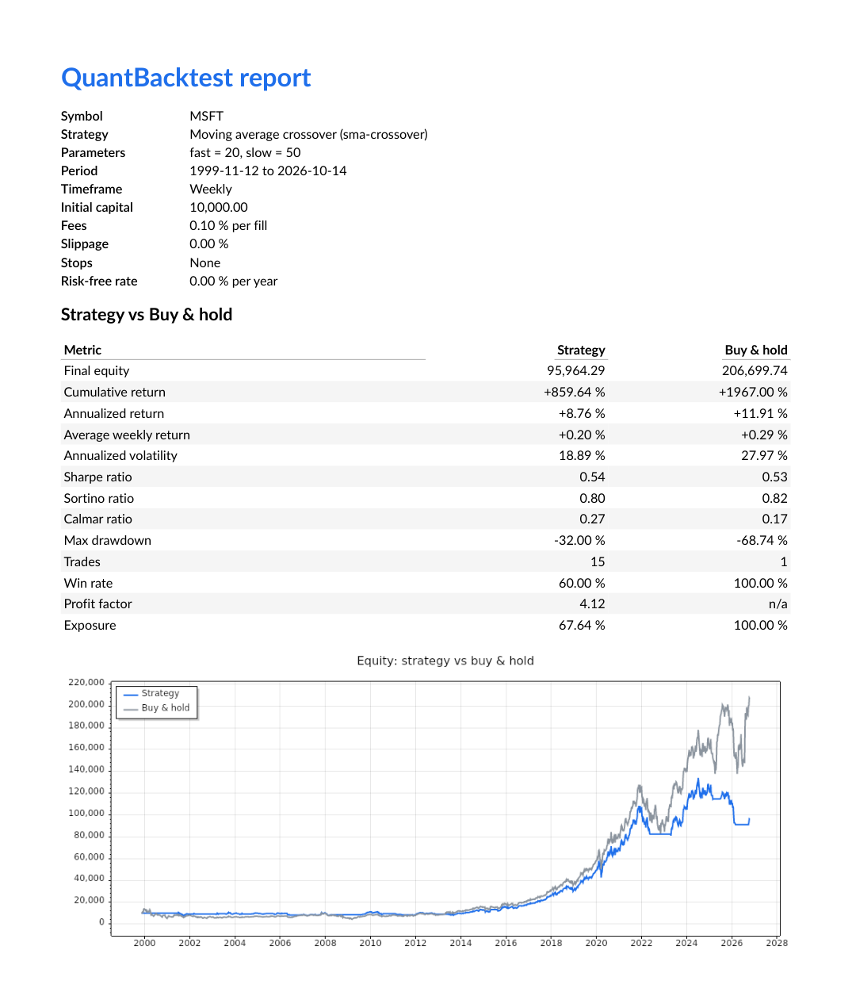
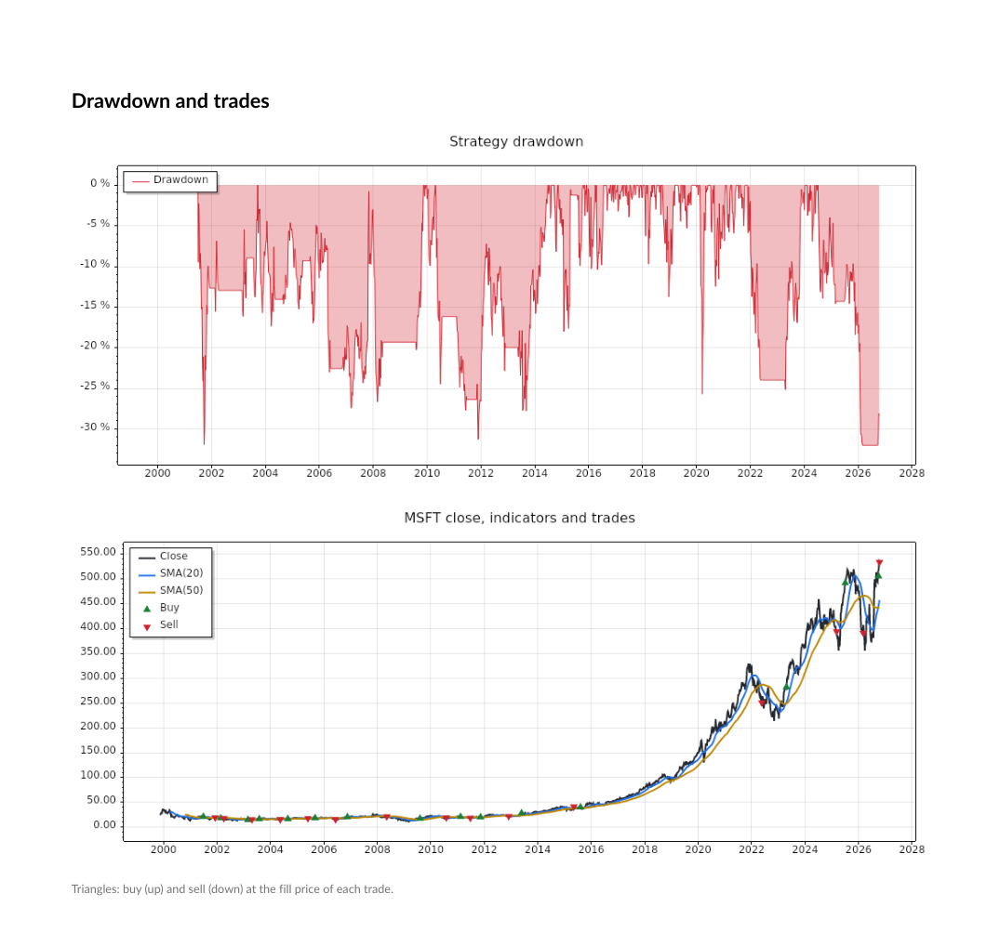
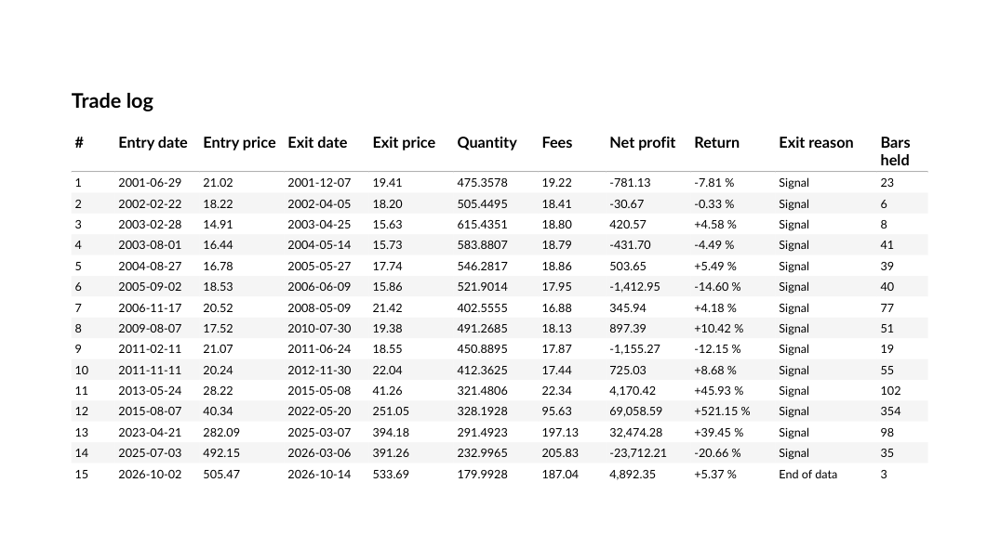
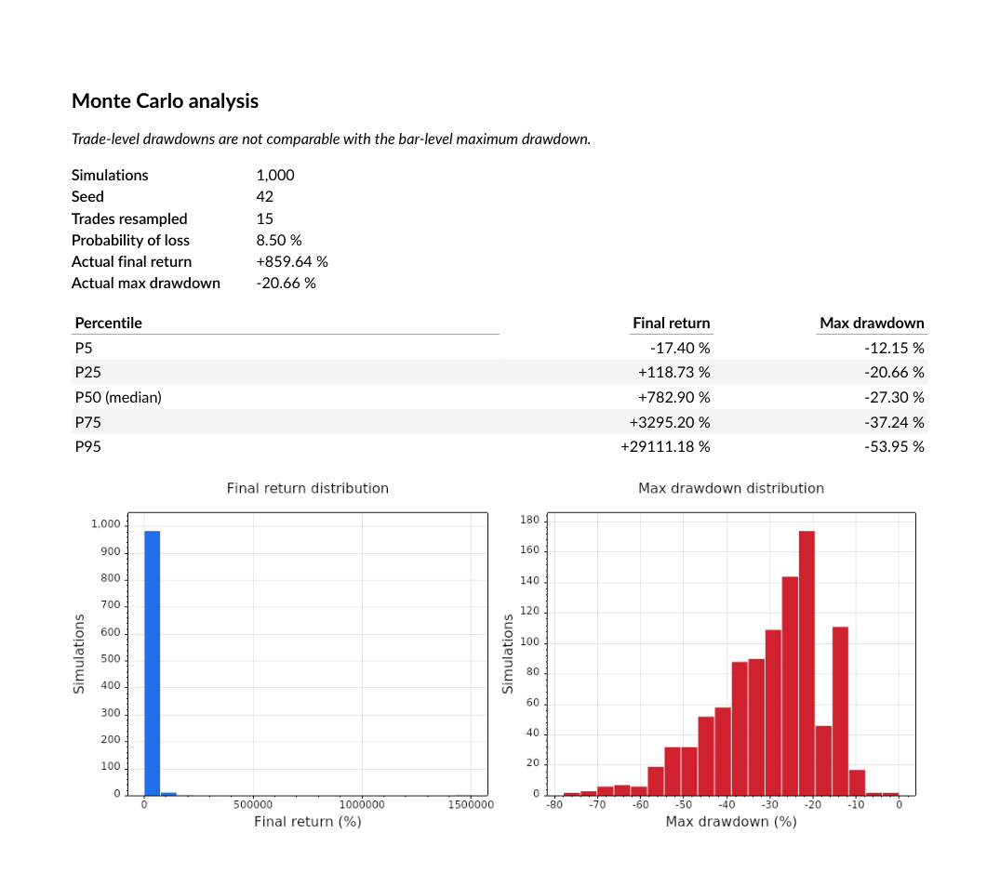
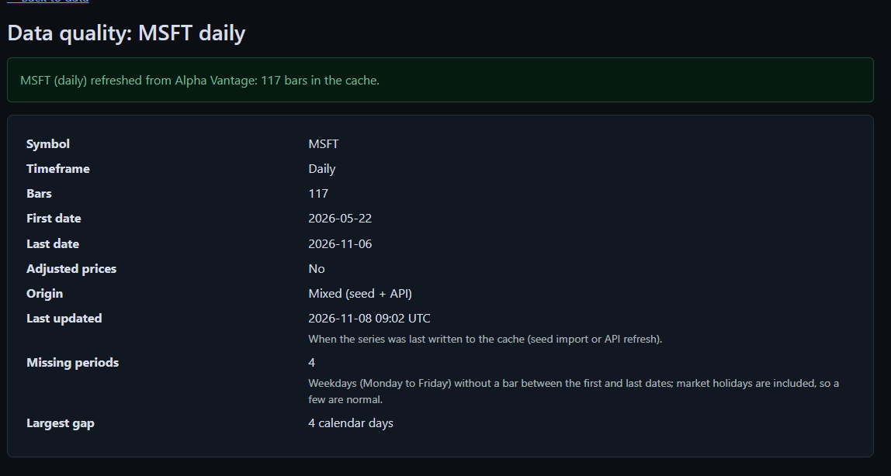
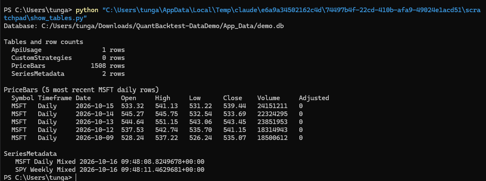

# Part 1 - Data layer and reports

## Objective

Part 1 gives the rest of the platform clean, reproducible price series, keeps what users save, turns a finished
backtest into documents, and makes the application runnable with one command. It is the only part that talks to
Alpha Vantage and the only part that writes to the database. The other parts only see the interfaces of `Core`.

This section covers sections 3 (data layer) and 8 (reports and deployment) of the final report.

| Interface (`Core`) | Implementation | Project | Role |
|---|---|---|---|
| `IMarketDataService` | `MarketDataService` | `QuantBacktest.Data` | Price series, cached symbols, data quality report, API quota |
| `ICustomStrategyStore` | `SqliteCustomStrategyStore` | `QuantBacktest.Data` | Persistence of the no-code strategies |
| `IReportGenerator` | `PdfReportGenerator` | `QuantBacktest.Reports` | PDF report and trades CSV |

The classes behind them stay `internal`: no `DbContext`, entity or HTTP client is visible outside the project.

## Design choices

### Alpha Vantage free plan: endpoint spike (P1-D5)

Tested on 2026-10-15 with a free API key, symbol `MSFT`, `datatype=csv`:

| Endpoint | Result | Bars | First -> last date |
|---|---|---|---|
| `TIME_SERIES_DAILY`, `outputsize=compact` | Accepted | 100 | 2026-05-22 -> 2026-10-14 |
| `TIME_SERIES_DAILY`, `outputsize=full` | Refused (premium feature) | - | - |
| `TIME_SERIES_DAILY_ADJUSTED` | Refused (premium endpoint) | - | - |
| `TIME_SERIES_WEEKLY` | Accepted | 1406 | 1999-11-12 -> 2026-10-14 |
| `TIME_SERIES_WEEKLY_ADJUSTED` | Accepted | 1406 | 1999-11-12 -> 2026-10-14 |

Refusals arrive with HTTP 200 as a JSON `Information` message, even when CSV is requested.

**Decisions**

- Daily data uses `TIME_SERIES_DAILY&outputsize=compact` (raw prices, last 100 bars).
- Weekly data uses `TIME_SERIES_WEEKLY_ADJUSTED`: it is free and gives 27 years of split- and dividend-adjusted prices.
  The adjustment factor `adjusted close / close` is applied to open, high, low and close; the volume stays raw (P1-D7).
  Adjusted prices are rounded to 6 decimals; rounding is monotonic, so the OHLC ordering of a bar is preserved.
- Long daily history: no third-party source is used, to avoid any licensing doubt. Daily backtests are limited to
  the 100 bars of the free plan and long demonstrations use the weekly timeframe.
  A daily series is therefore never adjusted, and the report shows the "not adjusted" warning for it.

### Parsing and error handling

- The CSV parser accepts exactly two headers: the raw one (`timestamp,open,high,low,close,volume`) and the one of
  the adjusted endpoints (`...,adjusted close,volume,dividend amount`). Anything else is an `InvalidResponse`.
- Numbers are always parsed with `CultureInfo.InvariantCulture`; thousands separators are rejected.
- A line that is malformed, has a non-positive price or a negative or fractional volume, or breaks the bar
  invariants (`High >= max(Open, Close)`, `Low <= min(Open, Close)`) is dropped with a logged warning. It is never
  repaired. When a date appears twice, the first line (the most recent in Alpha Vantage order) is kept.
- JSON errors received with HTTP 200 are classified as follows: `Error Message` gives `SymbolNotFound`; `Note`
  gives `RateLimitExceeded`; an `Information` text about a rate limit or call frequency gives `RateLimitExceeded`; an
  `Information` text about a premium feature gives `InvalidResponse`; anything else gives `InvalidResponse`.
  The rate limit check comes first because Alpha Vantage's rate limit notice also mentions premium plans.
- Error messages are written by QuantBacktest and never copied from Alpha Vantage: its rate limit notice repeats the
  API key. Inner exceptions are not attached, and the request URL (which contains the key) is never logged.
  The HTTP client's own request logging is removed with `RemoveAllLoggers()`.
- A timeout (30 s) or connection failure gives `NetworkError`; a cancellation requested by the caller is propagated
  as an `OperationCanceledException`, not reported as a network error.

### Local cache (SQLite)

- EF Core with SQLite, schema created with `EnsureCreated()` once per process behind a lock; no migrations.
  Four tables: `PriceBars` (key symbol, timeframe, date), `SeriesMetadata` (origin, last fetch), `ApiUsage`
  (requests per UTC day) and `CustomStrategies` (definitions stored as JSON).
- Decimals are stored as text by the SQLite provider, so prices are kept exactly; queries only sort by date and every
  computation runs in memory.
- A download is merged by date: new dates are inserted, existing dates are replaced, and no cached bar is ever deleted.
  The origin of a series becomes `Mixed` as soon as bars of another origin are added; a series is adjusted only if
  every one of its bars comes from an adjusted source.

### Market data service

- `GetSeriesAsync` without refresh returns the cache when it has data, without any API call, so a backtest gives the
  same result every time. An empty cache is filled from the seed file when there is one, otherwise from the API.
  With `forceRefresh`, the API is called and the bars are merged; a failure leaves the cache untouched.
- Seed files (`data/seed/`) are snapshots of the free Alpha Vantage endpoints taken on 2026-10-15: 100 daily bars and
  the weekly adjusted history since 1999 for `AAPL`, `MSFT`, `SPY` and `JPM`. They make the application usable without
  an API key, for example in Docker.
- Quota: each HTTP request is counted per UTC day before it is sent, so a failed request counts too. The quota is
  checked first, then the key; a missing key sends nothing and counts nothing.
- Concurrency: one lock per symbol and timeframe, and simultaneous calls share the download in progress, so ten
  simultaneous calls send one HTTP request. A caller that cancels stops waiting without cancelling the shared download.

### Custom strategy store

- Each no-code strategy is stored as one JSON document (camelCase, enums as text) in `CustomStrategies`, next to its
  name for sorting. It is read back member for member identical, rule lists included. The store validates nothing:
  Part 2 validates the rules and Part 4 calls that validation before saving.

### Data quality report

- Computed on the cached series only, never through the API (`NotCached` otherwise). It flags price jumps above
  25 %, zero volumes, runs of 5 identical closes (one anomaly per run, dated the 5th bar) and calendar gaps above
  5 days (daily) or 10 days (weekly), and counts the missing weekdays (daily) or missing weeks (weekly).
  Market holidays count as missing weekdays, as the contract specifies.

### PDF report

- QuestPDF (Community license) lays out an A4 portrait report in English; ScottPlot draws the charts as PNG images.
  Every number is printed as it comes in `BacktestResult` and `MonteCarloResult`: the report recomputes nothing.
- Display culture is fixed to `en-US`. Performance figures (returns) are signed percentages (`+12.34 %`), the
  maximum drawdown is shown as a loss (`-23.45 %`), non-negative figures (volatility, win rate, exposure) and
  settings (fees, slippage, stops, risk-free rate) are unsigned percentages, amounts use thousands separators and
  2 decimals, ratios 2 decimals, undefined ratios read `n/a`.
- The generation date in the footer comes from the injected clock, so tests are reproducible.
- Page 1: settings, the "not adjusted" warning when needed, the 13 metrics against buy & hold and the equity curve.
  Page 2: the strategy drawdown, and the closes with the price indicators and buy (up) and sell (down) triangles at
  the fill prices. Then the trade log: every field of every trade, the header repeated on each page.
- When a Monte Carlo result is given, a last page shows the two histograms, the P5 to P95 percentiles of final returns
  and drawdowns, the probability of loss, the values of the actual trade order and the reminder that trade-level
  drawdowns are not comparable with the bar-level maximum drawdown. Oscillator indicators (RSI...) get their own chart
  below the price, with their reference lines.
- `BacktestResult` does not carry the rules of a no-code strategy, so the generator reads them from Part 2's
  `IStrategyCatalog` (a Core interface, injected) for `custom-*` ids only, and prints the entry and exit rules on page 1.
- The trades CSV follows the contract format exactly (invariant culture, `
` line endings, header always present,
  RFC 4180 quoting if a field ever needed it).

### Docker

- Multi-stage `Dockerfile`: the .NET 10 SDK image restores, builds with `-warnaserror` and runs every test before
  publishing, so an image only exists for a green solution; the ASP.NET 10 runtime image runs the application as the
  non-root `app` user, with `fontconfig` and the DejaVu fonts needed by the PDF and its charts.
- `docker-compose.yml` starts one `web` service on port 8080 in `Production` (no fakes). The SQLite database lives in
  a named volume mounted on `/data`, the seed files are copied into the image (`/app/seed`), and the API key comes
  from a local `.env` file (`.env.example` is the committed template, with an empty key). Without a key the
  application still serves the seed data.

## How it works

### Loading a series (rules D2, D3, D4)

`GetSeriesAsync(symbol, timeframe, forceRefresh)` first trims and upper-cases the symbol and checks it against
`Conventions.SymbolPattern`. Then:

1. **Without refresh, cache not empty**: the cached series is returned and no API call is made, so the same backtest
   always gives the same result.
2. **Without refresh, cache empty**: the seed file `data/seed/<SYMBOL>_<timeframe>.csv` is imported if it exists
   (origin `Seed`); otherwise the API is called (origin `Api`).
3. **With refresh**: the API is called and the bars are merged by date. If the call fails, the exception reaches the
   caller and the cache is unchanged. Adding API bars to a seed series changes its origin to `Mixed`.

### One call to Alpha Vantage (rule D4)

1. The quota is checked: when `UsedToday >= DailyRequestLimit`, the service raises `RateLimitExceeded` without calling.
2. The key is checked: when it is missing, the service raises `MissingApiKey` without calling or counting.
3. The request is counted in `ApiUsage`, then sent, so a failed request counts too.
4. A network error, a timeout or a status other than 200 gives `NetworkError`.
5. A body that starts with `{` is a JSON error sent with HTTP 200: it is classified and raised.
6. Otherwise the CSV is parsed, the bars are merged and the merged series is returned.

Simultaneous calls for one series go through one lock per (symbol, timeframe) and share the download in progress:
ten simultaneous calls send one HTTP request.

### Data quality report (rule D7)

`GetQualityReportAsync` reads the cache only and raises `NotCached` otherwise. One pass over the bars finds the
anomalies, the largest calendar gap and the missing periods. On the real data it flags, for example, the 11-day gap
of SPY in September 2001, when the US markets closed after the 11 September attacks.

### PDF report

`PdfReportGenerator` receives a finished `BacktestResult` and, optionally, a `MonteCarloResult`. `ReportContent` turns
them into texts, `ChartRenderer` draws the PNG charts and `BacktestReportDocument` lays out the pages:

| Page | Content |
|---|---|
| 1 | Settings, entry and exit rules of a no-code strategy, "not adjusted" warning, 13 metrics against buy & hold, equity curve |
| 2 | Strategy drawdown, closes with price indicators and trade markers, oscillators when there are any |
| 3 and following | Trade log, with the header repeated on each page |
| Last (optional) | Monte Carlo: settings, percentiles, probability of loss, actual values, two histograms |

### Running with Docker

```bash
cp .env.example .env          # optional: put the Alpha Vantage key in it
docker compose up --build     # then open http://localhost:8080
```

The image is built only when the whole solution compiles with `-warnaserror` and every test passes. The database is
kept in the named volume `quantbacktest-data` when the container is recreated.

## Tests

The tests use xUnit and FluentAssertions, and each one cites the rule it checks. They are deterministic: HTTP goes
through a fake handler that counts the calls, the clock is injected, and each database is a temporary SQLite file
deleted after the test.

| Project | Tests | What they cover |
|---|---|---|
| `QuantBacktest.Data.Tests` | 124 | CSV parser (also under `fr-FR`), each D4 error case, key never in a message or a log, D2/D3 algorithm, origin, quota and its UTC reset, concurrency, adjustment, `PriceSeries` invariants, merge by date, strategy store round trip, the 4 quality anomalies with values computed by hand, committed seed files, end-to-end dependency injection |
| `QuantBacktest.Reports.Tests` | 55 | Display formats, every cell of the metrics table, page count, A4 format, date from the injected clock, 0 to 1,000 trades, 2 bars, no indicators, Monte Carlo page, CSV compared character by character with a hand-written string |

Checks done by hand, in addition to the automated tests:

- **Real API**: from the application running in Docker, a refresh of MSFT daily merged the new bars into the seed
  series (117 bars, last bar 2026-11-06) and the origin became `Mixed`. A first test with a console program had
  already added one bar by merge and counted 1 request in the quota.
- **API key**: after that refresh, the whole container log was searched for the key, for `apikey=` and for the
  Alpha Vantage host name: 0 occurrences of each.
- **Docker**: `docker compose up --build` on Docker Desktop built the image with the tests inside it. The application
  answered on port 8080, ran as the non-root `app` user and created its database in the `/data` volume.
- **Real PDF**: for MSFT weekly with the SMA crossover, the 15 net profits add up to the final equity (10,000 +
  85,964.29 = 95,964.29), and the cumulative return, annualized return, Calmar ratio, win rate and profit factor were
  recomputed by hand from the printed values and match.

## Screenshots

The PDF images are the pages of a report generated by the application running in Docker (MSFT weekly, SMA crossover
20/50, 1,000 Monte Carlo simulations).



*PDF report, page 1: settings, metrics against buy & hold, equity curve.*



*PDF report, page 2: drawdown, closes, SMA indicators and trade markers.*



*PDF report: trade log, with the exit reason and the bars held of each trade.*



*PDF report: Monte Carlo page, with the percentiles and the two histograms.*



*Data page of the application after a real refresh from Alpha Vantage: 117 bars, origin `Mixed` (seed + API).*



*The SQLite cache read from a terminal: the four tables, recent rows of `PriceBars` and `SeriesMetadata` (database of
a console run of the data layer, same schema as the application).*

The endpoint spike is recorded as a table in Design choices. The results of the tests, the key search in the logs and
the Docker run are described in the Tests section.

## Limitations

- **Short daily history.** The free plan gives 100 daily bars, so long backtests, the heatmap and train/test are
  more meaningful in weekly.
- **Daily prices are not adjusted.** A split inside the 100 daily bars would appear as a price jump. The report and
  the quality page make this visible, but the prices are not corrected.
- **Frozen seed files.** They are snapshots taken on 2026-10-15. Their last weekly bar (2026-10-14) is a week still in
  progress at that date. A refresh updates a series on demand.
- **Seed data licensing.** The seed files are Alpha Vantage data committed for this academic project. No third-party
  source was added, but Alpha Vantage's redistribution terms were not reviewed for any wider use.
- **Local quota counter.** It only counts the requests of this application. Requests made with the same key elsewhere
  are unknown to it, and Alpha Vantage may then refuse a call earlier than the counter suggests.
- **Blocking catalog lookup.** `IReportGenerator.GeneratePdf` is synchronous by contract, so reading the rules of a
  no-code strategy waits on an asynchronous call.
- **PDF text is not read by the tests.** No package to extract PDF text is allowed, so the printed texts are tested
  before layout (`ReportContent`) and the page structure through the document itself.
- **Monte Carlo histograms.** The bins have equal width (rule MC6), so one very large resampled return can squeeze the
  final return histogram into a few bars. The percentile table remains readable.
- **ASP.NET data protection keys** are stored in the container and are regenerated when it is recreated.
