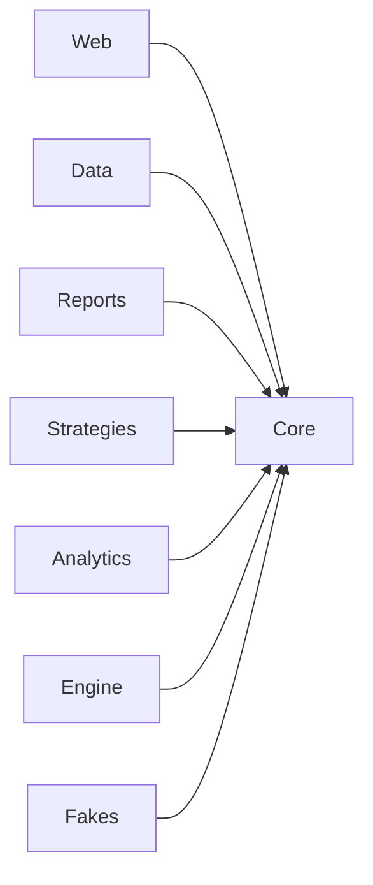
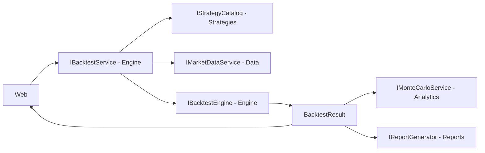

# Part 3 - Backtesting engine and metrics

## Objective

Part 3 is the calculation core of QuantBacktest. Given a price history and a strategy, it simulates the trades
(fees, slippage, stop-loss, take-profit, trailing stop), computes every performance metric, and builds the
optimisation heatmap. The other parts only display these numbers: nobody else recomputes them.

The code is in `src/QuantBacktest.Engine` and is split in small classes:

| Class | Role |
|---|---|
| `PerformanceCalculator` | The 14 metrics (M1 to M14), from an equity curve. Does not know the engine. |
| `BacktestEngine` | The simulation of one backtest. Pure: no network, no database, no file, no clock. |
| `SimulatedPortfolio` | The cash, the position and the list of trades during a simulation. |
| `RequestValidator` | All the checks on a request (symbol, timeframe, parameters, execution settings). |
| `BacktestService` | Finds the strategy, validates, loads the prices, calls the engine. |
| `ParameterSweepService` | The heatmap: one backtest per pair of parameter values. |
| `SweepAnalysis` | Best cell and overfitting warning of a finished grid (pure function). |

## Design choices

**One simple execution model.** The strategy gives one signal per bar, at the close. The engine executes it at the
**Open of the next bar** (rule X4). So a signal can never use a price that did not exist yet: there is no look-ahead.
The position is long only, with 100 % of the cash and no leverage (X5).

**Prices and money in `decimal`, statistics in `double`.** Money must be exact, but a square root or a power
needs a `double`. The `decimal` equity is converted to `double` only when the returns are computed.

**Fees and slippage (X6).** A buy is filled at `price x (1 + slippage)` and a sale at `price x (1 - slippage)`.
The quantity is `q = cash / (fill x (1 + fee))`, so the fee is paid out of the cash and the position is fractional.

**Prudent order for the protective exits (X8).** When a stop and a target are both reached during the same bar,
we cannot know which came first, so the engine always assumes the **stop came first**. If the bar opens already
beyond a level (a gap), the exit is at the Open, not at the level: this is what would really happen.

**A strategy is not trusted blindly.** If it returns the wrong number of signals the engine throws an
`InvalidOperationException` (a bug), whereas a user mistake throws a `BacktestValidationException` (a message
shown to the user). Both kinds are kept apart on purpose.

**No `NaN`, no infinity (M14).** A ratio that cannot be defined (for example the Sharpe ratio of a flat curve) is
`null` and shown as "n/a" by the web layer, never replaced by 0.

**Heatmap.** The prices are loaded once, then every cell goes through the same validation and the same engine as a
normal backtest. An invalid combination (for example `fast >= slow`) gives an empty cell with the error message
instead of stopping the whole grid. Cells are computed one after the other, which keeps the result deterministic.

## How it works

### One bar of the simulation (rule X7)

For every bar `i` of the period, in this order:

1. execute at the Open the signal of bar `i-1` (buy if flat, sell if long, otherwise nothing);
2. if a position is open, check the stop-loss, the trailing stop and the take-profit;
3. if it is the last bar and a position is still open, sell it at the Close (`EndOfData`);
4. record the equity `cash + quantity x Close`.

The signals before the period are ignored, but the strategy still receives these bars so that its indicators are
warmed up (X2). Only the part of each indicator inside the period is returned.

### Protective exits (X8, X9)

With `E` the entry fill and `peak` the highest `High` since the entry (before the current bar):

- stop level `S` = the highest of `E x (1 - stop-loss)` and `peak x (1 - trailing)`;
- target `T = E x (1 + take-profit)`;
- gap (not on the entry bar): `Open <= S` exits at the Open, else `Open >= T` exits at the Open;
- during the bar: `Low <= S` exits at `S`, else `High >= T` exits at `T`.

The exit reason is `TrailingStop` if the trailing level is strictly higher than the stop-loss level, otherwise
`StopLoss`. The exit price then goes through the slippage and the fee like any other sale.

### Metrics (M1 to M12)

`P` is 252 (daily) or 52 (weekly), `r_t = E_t / E_(t-1) - 1`, `rf_p = risk-free rate / P`.

| Metric | Formula |
|---|---|
| Cumulative return | `final equity / capital - 1` |
| Annualised return | `(final equity / capital) ^ (1 / years) - 1`, `years = days / 365.25` |
| Volatility | sample standard deviation of `r_t` (divided by `n - 1`) times `sqrt(P)` |
| Sharpe | `(mean(r_t) - rf_p) / std(r_t) x sqrt(P)` |
| Sortino | `(mean(r_t) - rf_p) / DD x sqrt(P)`, `DD = sqrt(sum(min(0, r_t - rf_p)^2) / n)` |
| Max drawdown | largest `(peak - equity) / peak`, the peak starting at the capital |
| Calmar | `annualised return / max drawdown` |
| Win rate | share of trades with a positive net profit |
| Profit factor | sum of the gains / absolute sum of the losses |
| Exposure | share of the points where a position was held |

The benchmark (buy and hold) uses the same formulas on its own equity curve (M13).

### Heatmap (O1 to O5)

An axis gives `Min + k x Step` up to `Max`, rounded to 10 decimals (so `0.01 + 0.01 + 0.01` is `0.03`, not
`0.030000000000000002`). The best cell is the highest value (ties: smallest `Y`, then smallest `X`). The overfitting
warning is raised when the best value is positive and the average of its neighbours is under half of it: a lonely
peak surrounded by bad cells is probably luck, not a robust setting.

## Tests

The Engine test project has 184 tests, none of them uses the network. Expected values are **recomputed in the test
with the formula** (written in a comment), never copied from the output of the engine.

| File | What it checks |
|---|---|
| `PerformanceCalculatorTests` | The metrics on small hand-made curves (for example `[100, 110, 99, 108.9]`), daily and weekly, and the degenerate cases (one point, flat curve, no trade). |
| `BacktestEngineScenarioTests` | Scenarios S1 to S5 and S11 and the benchmark, on a 6-bar series. |
| `ProtectiveExitTests` | Scenarios S6 to S10, the gaps, the slippage on exits, the re-entry after a stop. |
| `BacktestEnginePropertyTests` | On 5 synthetic series with random signals: equity never negative, final equity = capital + sum of the profits, trades never overlap, no look-ahead, exposure. |
| `BacktestEngineValidationTests`, `BacktestServiceTests` | Every rejected request, with its message; `MarketDataException` passes through unchanged. |
| `SweepAnalysisTests`, `ParameterSweepServiceTests` | The axes, the invalid cells, the order of the cells, the cancellation, the best cell and the overfitting warning; 625 cells on 1250 bars in a few seconds. |

The strategies used in the tests are `ScriptedStrategy` (returns signals written in the test) and
`TwoParameterStrategy`. The Engine never depends on the real strategies of Part 2.

**Check with the real strategies.** Once Parts 1 and 2 were merged, each real strategy was run with its default
parameters (and a 10 % stop-loss, 15 % trailing stop) on the SPY seed file, daily and weekly. No exception was
thrown, and a heatmap of `sma-crossover` (fast 5 to 25, slow 30 to 70) was computed.

## Screenshots

To be added by the author at the moments listed in `docs/parts/PART-3.md` (section 11). Images go in
`docs/report/images/`.

| File | Caption |
|---|---|
| `part3-01-metrics-test.png` | The test of the curve `[100, 110, 99, 108.9]` passing, with the formulas visible in the code. |
| `part3-02-hand-check-spreadsheet.png` | A spreadsheet recomputing scenario S1 by hand: quantity, fees, proceeds, equity per bar. |
| `part3-03-engine-tests.png` | The scenarios and the properties passing (`dotnet test`). |
| `part3-04-lookahead-property.png` | The "no look-ahead" test passing. |
| `part3-05-validation-tests.png` | The validation tests of the service. |
| `part3-06-protective-exits.png` | Tests S6 to S10 passing, with the spreadsheet of case S6 (gap). |
| `part3-07-sweep-tests.png` | The heatmap tests (O1 to O5) passing. |
| `part3-08-results-real.png` | Metrics of a real backtest with stops, strategy against buy and hold. |
| `part3-09-trades-exit-reasons.png` | The trade log showing several exit reasons. |
| `part3-10-heatmap-real.png` | A real heatmap with the overfitting warning. |
| `part3-11-pr-<n>.png` | The page of each merged pull request (#24 to #29): both CI checks green, ready to squash and merge. |

## Limitations

- **Long only.** There is no short selling and no leverage; the position always uses 100 % of the cash.
- **Execution at the Open.** Outside the protective exits, every order is filled at the next Open, with no
  volume limit: a large order would not move the price here, which is optimistic.
- **Stops depend on the bar.** With daily or weekly bars we cannot know the order of the High and the Low inside
  a bar. The "stop first" assumption is prudent but it is still an assumption. On weekly bars it matters more.
- **Dividends.** If the prices are not adjusted (the free daily data is raw), dividends are ignored and the
  results are slightly pessimistic. The result tells it through `PricesAdjusted`.
- **No tax and no interest on the cash.** The cash earns nothing while the strategy is out of the market.
- **Optimisation is not proof.** The best cell of a heatmap is chosen on the same data it is measured on, so it
  is optimistic. The overfitting warning and the train/test split of Part 4 exist for this reason.
- **Past results do not predict the future.**

---

# Final report, section 2 - Architecture

The solution is cut in layers around one shared project, `QuantBacktest.Core`.

**The contract.** `Core` contains only interfaces (`IMarketDataService`, `IStrategy`, `IBacktestEngine`...), the
data models (`PriceSeries`, `BacktestResult`...) and the constants. Its meaning is written in `docs/CONTRACT.md`,
with numbered rules (X8, M7, O4...) that the code, the tests and this report all quote. The contract is frozen:
it can only change by a team decision.

**One rule of gold.** A project never references the project of another part, only `Core`. The parts talk to each
other through the interfaces, which are injected by dependency injection. Only `Web` knows every project, because
it is the place where everything is plugged together (`AddQuantBacktestData`, `AddQuantBacktestEngine`...).

**Request flow of a backtest.**

The web layer sends a `BacktestRequest`. The service validates it, gets the strategy from the catalog and the prices
from the data service, and gives both to the engine. The engine returns a `BacktestResult` that the web layer
displays, and that the Monte Carlo and the PDF report take as input.

**Fakes and parallel work.** The `Fakes` project gives a plausible fake of every interface and a deterministic
price generator. As the four of us worked at the same time, the web layer could be built before the real engine
existed: one setting per part (`QuantBacktest:UseFakes:Engine`...) chooses between the real service and the fake.
The fakes are not a reference of the behaviour; the contract is.
